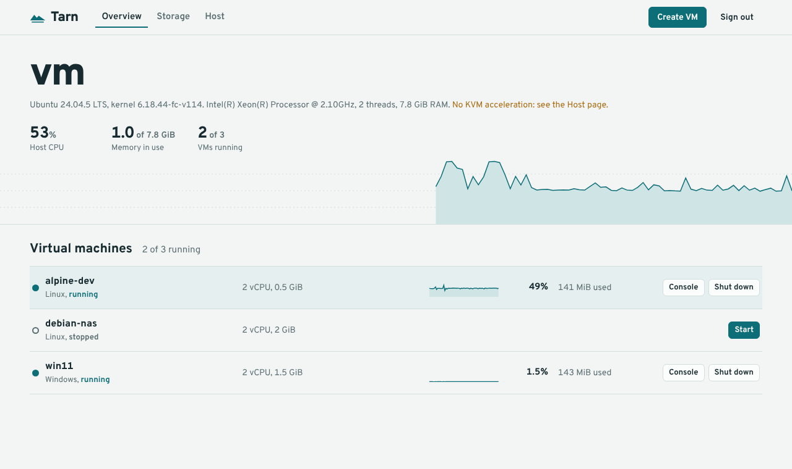
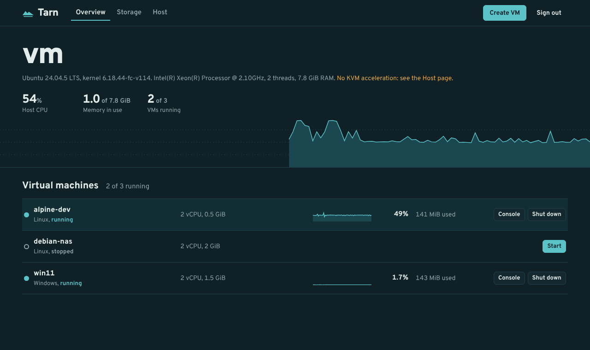
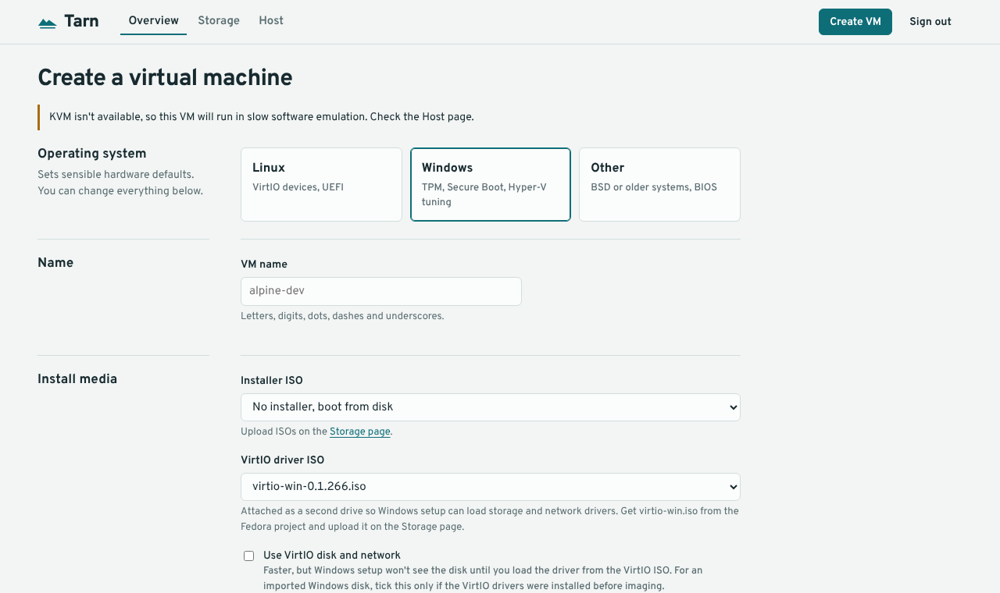
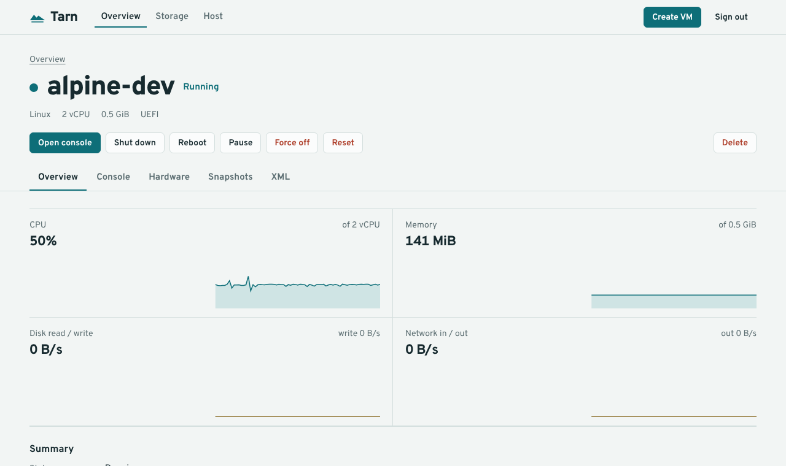
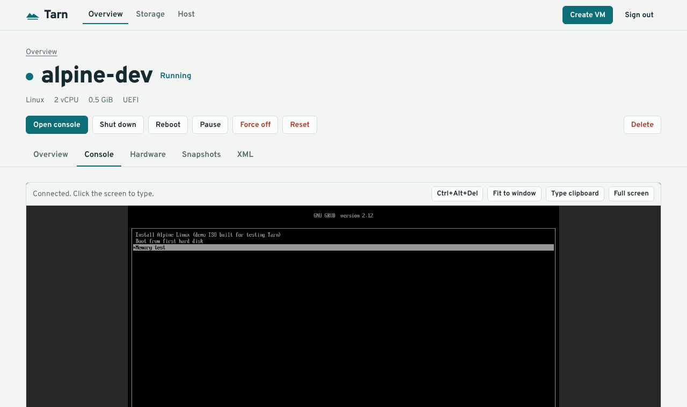

<div align="center">

<picture>
  <source media="(prefers-color-scheme: dark)" srcset="docs/brand/logo-dark.svg">
  
</picture>

# Tarn

**A small, Proxmox-style manager for a single KVM/libvirt host, built for Alpine Linux.**


**[Try the live demo](https://tarn.raigonpawa.dev/)** · [Download 0.1.0](https://github.com/raigon-pawa/tarn/releases/latest)



</div>

Tarn is a single Python process that talks to libvirt and gives you a browser
UI and a native GTK desktop app for running virtual machines on one host. It
covers live CPU ridgelines, a create/import wizard with Windows and Linux
templates, an in-browser console, snapshots, ISO uploads, PCI/GPU passthrough
with Looking Glass, and a host readiness checklist.

Want to look around first? The [live demo](https://tarn.raigonpawa.dev/)
runs the real web UI in your browser against a simulated host, so you can
create VMs, take snapshots and type into a console without installing
anything.

It is deliberately thin. libvirt already does the hard parts (QEMU process
management, storage pools, NAT networking, firmware selection, TPM emulation).
Tarn is the management layer on top, small enough to read in a weekend and
change freely. There is no build step, no database and no container runtime.

---

## Contents

- [Features](#features)
- [Screenshots](#screenshots)
- [Quick start](#quick-start)
- [Development](#development)
- [Architecture](#architecture)
- [Security model](#security-model)
- [REST API](#rest-api)
- [Scope and roadmap](#scope-and-roadmap)
- [Credits](#credits)

## Features

| Area | What you get |
|---|---|
| **Overview** | Live CPU ridgelines for the host and every VM, plus memory, battery, CPU temperature and power profile |
| **Create VM** | Linux, Windows and Other templates; new disk or import an existing image; install ISO plus VirtIO driver ISO; UEFI, Secure Boot and TPM 2.0; NAT or bridged networking |
| **VM page** | Live charts, noVNC console (Ctrl+Alt+Del, paste-as-typing, full screen), CPU/memory, rename, autostart, CD swap, boot order, snapshots, raw XML editor |
| **GPU passthrough** | Attach every function of a card to one guest root port, CPU pinning to one L3 cluster, Looking Glass via `/dev/kvmfr0`, and a guard so two VMs never hold the same GPU at once |
| **Storage** | Pools and volumes, ISO upload streamed straight into a libvirt volume, new disks |
| **Host** | Readiness checklist with copy-paste fix commands, IOMMU groups, GPUs and their drivers, power and temperatures |
| **Desktop mode** | Native GTK3 app (`tarn desktop`) that runs full screen under labwc on the host's own display, with a top panel for Wi-Fi, Bluetooth, sound, brightness and battery |
| **Install** | One idempotent installer for Alpine (OpenRC) and Fedora (systemd) that sets up TLS, a service user and the admin password |

## Screenshots

| Overview (dark) | Create VM |
|---|---|
|  |  |
| **VM detail** | **Console** |
|  |  |

## Quick start

### Alpine Linux (primary target)

```sh
git clone https://github.com/raigon-pawa/tarn.git
cd tarn
doas sh install.sh
```

The installer enables the community repo and installs QEMU/KVM, libvirt, swtpm
and the Python bindings from Alpine's own packages (no pip, so musl wheels are
never a problem). It also loads the KVM modules, gives the `libvirt` group
access to libvirtd, creates a `tarn` service user, generates a self-signed TLS
certificate, asks for the admin password, and starts the OpenRC service.

Open `https://<host-ip>:8006` and accept the certificate once.

Run the installer again to upgrade. It never overwrites your config, password
or certificate.

| Option | Effect |
|---|---|
| `--no-pkgs` | Skip package installation (offline upgrades) |
| `--desktop USER` | Also install the native app and labwc kiosk for `USER`; start it with `tarn-kiosk` |
| `--desktop USER --autostart` | Log `USER` in on tty1 at boot, straight into Tarn |

A complete bare-metal walkthrough for a gaming laptop (BIOS, Alpine install,
Wi-Fi, parking a discrete NVIDIA GPU on `vfio-pci`, lid and battery handling)
is in [docs/ALPINE-LEGION.md](docs/ALPINE-LEGION.md).

### Fedora

The same installer works on Fedora, which is handy for trying Tarn before
moving a machine to Alpine:

```sh
sudo sh install.sh
```

It installs the `@virtualization` group, `python3-libvirt` and
`python3-aiohttp`, adds a systemd unit, and opens port 8006 in firewalld.

### Command line

```text
tarn serve            run the web server
tarn passwd           set the admin password
tarn check            print the host readiness checklist
tarn desktop          open the native window on this machine's screen
tarn looking-glass    open Looking Glass on the running VM that has it
```

## Development

Requirements: Python 3.11+, `libvirt-python`, `aiohttp`, and access to
`qemu:///system` (run as root or as a member of the `libvirt` group).

```sh
cp dev.example.toml dev.toml                  # plain HTTP on 127.0.0.1
python3 -m tarn --config dev.toml passwd
python3 -m tarn --config dev.toml serve       # http://127.0.0.1:8006
```

### Tests

The tests run against a real libvirtd, not mocks. They create and remove only
their own throwaway VMs (`alpine-test`, `win11-test`, `bios-test`), so they
are safe to run next to existing guests.

```sh
TARN_PASSWORD=... python3 tests/api_test.py                                # REST + console WebSocket
TARN_PASSWORD=... DEMO_ISO=/tmp/alpine-demo.iso python3 tests/ui_test.py   # Playwright, headless Chromium
```

`tests/make-demo-iso.sh` builds a tiny bootable ISO for the UI test.

### Demo site

`demo/` holds an in-browser mock of the API (`mock-api.js`) and a simulated
console. `sh demo/build.sh` combines them with the real `tarn/static` UI into
`_site/`, and `sh demo/publish.sh` pushes that to the `gh-pages` branch.

### Configuration

All settings live in `/etc/tarn/tarn.toml`. Every key is optional;
[`tarn.example.toml`](tarn.example.toml) documents each one and its default
(listen address and port, TLS paths, session length, libvirt URI, storage
pools, default network and stats sampling).

## Architecture

```text
 browser ──HTTPS──▶ tarn  (aiohttp, runs as user "tarn" in group "libvirt")
                     ├── REST API ──── libvirt-python ──▶ libvirtd ──▶ QEMU/KVM guests
                     ├── WebSocket ─── RFB bytes ──────▶ guest VNC (bound to 127.0.0.1)
                     ├── stats sampler (every 2 s, getAllDomainStats + /proc)
                     └── static UI: vanilla JS modules + noVNC, no build step
```

- **Everything goes through libvirt.** Disks are volumes in a libvirt storage
  pool and ISO uploads stream in through a libvirt stream, so Tarn never needs
  write access to the image directories.
- **A console without websockify.** Tarn asks libvirt for a socket straight
  into QEMU's VNC server (`openGraphicsFD`) and relays it over an
  authenticated WebSocket to noVNC.
- **Templates that boot.** Linux guests get Q35, UEFI, VirtIO everything and a
  guest-agent channel. Windows guests get Q35, UEFI with Secure Boot, an
  emulated TPM 2.0, Hyper-V enlightenments, and SATA plus e1000e so setup
  works without drivers (VirtIO is one tick away once `virtio-win.iso` is
  attached). Anything else can be changed in the XML tab.
- **Firmware autoselection.** On Alpine, `qemu-system-x86_64` ships the edk2
  builds and descriptors, including a Secure Boot one, so no separate OVMF
  package is needed.
- **Non-blocking.** libvirt-python is synchronous, so every call runs through
  `asyncio.to_thread` on the server, and through worker threads in the GTK app.

### Project layout

```text
tarn/
  __main__.py      CLI: serve, passwd, check, desktop, looking-glass
  web.py           HTTP routes, middlewares and app factory
  virt.py          libvirt layer: VMs, storage, networks, snapshots, passthrough
  domxml.py        domain XML templates and parsing
  console.py       WebSocket-to-VNC relay
  stats.py         background sampler and history
  host.py          /proc and /sys: readiness, IOMMU groups, battery, temps, GPUs
  auth.py          scrypt password, sessions, CSRF and origin checks
  config.py        TOML config with defaults
  desktop/         native GTK3 app (overview, create, VM and host pages, panel)
  static/          single-page web UI, vendored noVNC and Overpass fonts
install.sh         Alpine (OpenRC) and Fedora (systemd) installer
packaging/         OpenRC script, systemd unit, kiosk session, lid-screen daemon
tests/             API and Playwright UI tests
demo/              GitHub Pages demo: mock API, simulated console, build script
docs/              Alpine install guide and screenshots
```

## Security model

- **One admin account.** The password is stored as an scrypt hash in
  `/etc/tarn/passwd`. Five wrong attempts lock out that IP for five minutes.
- **HTTPS by default.** Plain HTTP needs `--insecure-http` or
  `allow_plain_http = true` and is meant for localhost development only.
- **Hardened sessions.** The session cookie is `HttpOnly` and
  `SameSite=Strict`. Every state-changing request needs an `X-Tarn: 1` header,
  and requests with a foreign `Origin`, including WebSocket handshakes, are
  refused.
- **Console isolation.** Guest VNC servers listen on 127.0.0.1 only, so the
  console is reachable only through Tarn's login.
- **Least privilege, with a caveat.** Tarn runs as an unprivileged `tarn`
  user, but membership of the `libvirt` group is effectively root on the host.
  Treat the admin password like a root password and **do not expose port 8006
  to the internet**. For remote access, use a VPN or
  `ssh -L 8006:localhost:8006`.

## REST API

Every endpoint is JSON under `/api` and needs a session cookie. Mutations also
need the `X-Tarn: 1` header.

| Method | Path | Description |
|---|---|---|
| POST | `/api/login`, `/api/logout` | Sign in / out |
| GET | `/api/host`, `/api/host/stats`, `/api/host/iommu` | Host facts and checks, live stats, IOMMU groups |
| GET / POST | `/api/vms` | List VMs with live stats / create a VM |
| GET / PATCH / DELETE | `/api/vms/{uuid}` | Details / rename, resources, autostart, boot order / delete (`?disks=1`) |
| POST | `/api/vms/{uuid}/action` | `start`, `shutdown`, `reboot`, `reset`, `poweroff`, `pause`, `resume` |
| GET | `/api/vms/{uuid}/stats` | Current numbers and 5-minute history |
| POST | `/api/vms/{uuid}/media` | Insert or eject an ISO |
| POST / DELETE | `/api/vms/{uuid}/pci[/{address}]` | Attach or detach a PCI device |
| GET / PUT | `/api/vms/{uuid}/xml` | Read or redefine the libvirt XML |
| GET / POST | `/api/vms/{uuid}/snapshots` | List or take snapshots |
| POST / DELETE | `/api/vms/{uuid}/snapshots/{name}[/revert]` | Revert or delete a snapshot |
| GET (WebSocket) | `/api/vms/{uuid}/vnc` | Console stream for noVNC |
| GET | `/api/storage`, `/api/networks`, `/api/meta` | Pools and volumes, networks and bridges, create-form data |
| PUT | `/api/storage/{pool}/upload?name=` | Stream a file into a new volume |
| POST / DELETE | `/api/storage/{pool}/volumes[/{name}]` | Create or delete a volume |

## Scope and roadmap

Tarn manages **one host**. Compared with Proxmox VE it has no clustering, live
migration or HA, no scheduled backups (snapshots only), no LXC containers, a
single admin account, and no firewall UI. Snapshots of a *running* UEFI VM
depend on your libvirt version; shutting the VM down first always works.

Ideas for what comes next:

- [ ] Export backups (`virsh backup-begin`)
- [ ] Download an ISO from a URL
- [ ] Incus containers next to VMs
- [ ] Hugepages and NVMe passthrough options in the UI
- [ ] SPICE or RDP console with audio for daily use

## Credits

[noVNC](https://github.com/novnc/noVNC) 1.7.0 (MPL-2.0) and the
[Overpass](https://overpassfont.org/) typeface (OFL-1.1) are vendored under
`tarn/static/vendor` with their licences.
